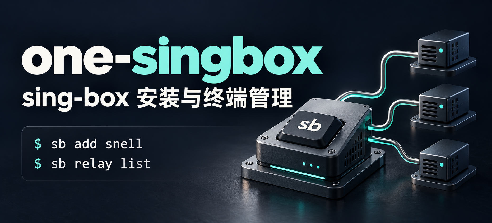
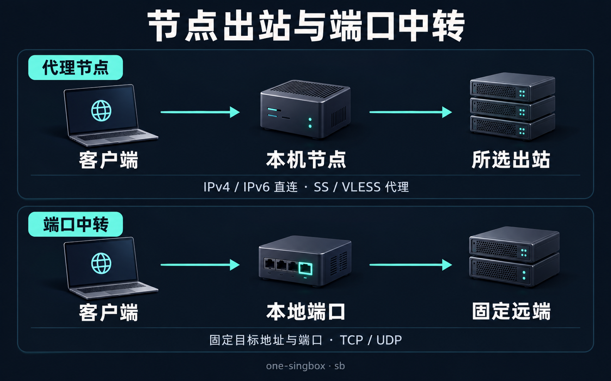

# one-singbox

<p align="center">
  
</p>

## 介绍

**one-singbox 是面向 Linux 服务器的 sing-box 安装与终端管理工具。** 通过交互式菜单和快捷命令 `sb`，管理代理节点、节点出站方式、TCP/UDP 端口中转及日常维护。

从[安装教程](#教程)开始，已有安装可直接查看[常用命令](#命令行)。

本项目基于 [233boy/sing-box](https://github.com/233boy/sing-box) 演进，在保留节点管理方式的基础上，围绕 Snell、节点出站、中转及维护功能持续开发。

| 能力 | 可以做什么 |
| --- | --- |
| 多协议节点管理 | 新增、修改、查看和删除多个节点，支持 VLESS-REALITY、TUIC、Trojan、Hysteria2、AnyTLS、Shadowsocks、VMess 等协议与部分传输组合。 |
| Snell 支持 | 创建和管理 Snell v6/v5 节点，导出 `snell://` URI 与 Surge 配置。 |
| 节点出站 | 为本机节点选择 IPv4/IPv6 直连方式，或通过 SS、VLESS 分享链接配置代理出站。 |
| TCP/UDP 中转 | 使用 sing-box 原生 `direct` 入站，将本地端口转发到固定的远端地址和端口。 |
| 日常维护 | 查看服务状态，更新脚本与内核，管理日志容量，为支持分享的节点显示二维码。 |

<p align="center">
  
</p>

节点出站与端口中转分别管理：前者决定本机代理节点的流量如何发出，后者转发一个本地端口到固定目标。协议、版本与分享限制见[详细使用说明](docs/usage.md)。

## 教程

### 安装条件

- 使用 **root** 用户，在可运行 Bash 的 Linux 服务器上操作；下面的安装命令需要 `wget`。
- CPU 架构为 **amd64/x86_64** 或 **arm64/aarch64**。
- 系统具有 `apt-get`、`yum`、`zypper` 或 `apk` 包管理器之一，并运行 **systemd** 或 **OpenRC**。
- 服务器能够下载 GitHub 上的脚本、内核及相关依赖。

以上是安装脚本检查的环境条件，不代表所有发行版版本均已逐一测试。Alpine 等精简环境需先准备 Bash 和 `wget`，再在 Bash 中执行安装命令。

### 安装并进入菜单

在 Bash 中执行：

```bash
bash <(wget -qO- -o- https://github.com/ouones/one-singbox/raw/main/install.sh)
```

安装过程会自动创建一个 **VLESS-REALITY** 节点，并显示节点信息。安装完成后，运行：

```bash
sb
```

主菜单提供“添加配置”“更改配置”“查看配置”“中转管理”等入口。首页同时显示服务状态与日志用量；**服务运行状态不代表外网连通性**。

### 创建节点并获取分享信息

可直接使用安装时生成的节点；需要其他协议或更多节点时，再按以下步骤新增。

1. 运行 `sb`，选择“添加配置”，再按提示选择协议、填写参数。
2. 创建后查看节点详情；也可通过“查看配置”重新选择节点。
3. 复制分享链接到支持该协议的客户端，或扫描详情中的二维码。Snell 提供 URI 和 Surge 配置，不生成二维码。
4. 根据所选协议，在服务器防火墙和云安全组中放行实际使用的 TCP/UDP 端口，再从客户端连接验证。

也可以直接指定协议添加，例如：

```bash
sb add snell
```

Snell 创建需要 sing-box 内核 **1.14.0 或更高版本**，默认创建 v6；AnyTLS 需要 **1.12.0 或更高版本**。需要域名及自动 TLS 的配置，请先阅读[协议与 TLS 条件](docs/usage.md#协议与-tls)。

更多操作见[使用说明](docs/usage.md)：[节点出站](docs/usage.md#节点出站)、[端口中转](docs/usage.md#端口中转)、[二维码](docs/usage.md#二维码与分享)、[日志管理](docs/usage.md#日志与容量限制)。中转无内置认证，使用前应通过防火墙或网络 ACL 限制来源。

## 命令行

下表中的 `节点名` 是脚本中显示的节点配置名，`本地端口` 是已有中转使用的监听端口，执行时请替换为实际值。运行 `sb` 可进入主菜单；省略部分参数时，脚本会交互询问。

### 节点管理

| 操作 | 命令 |
| --- | --- |
| 选择协议添加节点 | `sb add` |
| 添加 Snell 节点 | `sb add snell` |
| 修改节点 | `sb c 节点名` |
| 查看节点信息 | `sb info 节点名` |
| 查看分享链接 | `sb url 节点名` |
| 显示二维码（Snell 除外） | `sb qr 节点名` |
| 删除节点 | `sb del 节点名` |

**`sb del` 和批量删除命令 `sb ddel` 会直接删除配置，无需再次确认。**

### 节点出站

| 操作 | 命令 |
| --- | --- |
| 更改节点出站方式 | `sb c 节点名 outbound` |

### 端口中转

| 操作 | 命令 |
| --- | --- |
| 交互添加中转 | `sb relay add` |
| 列出中转 | `sb relay list` |
| 查看中转 | `sb relay info 本地端口` |
| 删除中转 | `sb relay delete 本地端口` |

**中转无内置认证；`sb relay delete` 会直接删除配置，无需再次确认。**

### 服务维护

| 操作 | 命令 |
| --- | --- |
| 查看服务状态 | `sb status` |
| 启动服务 | `sb start` |
| 停止服务 | `sb stop` |
| 重启服务 | `sb restart` |
| 查看日志 | `sb log` |
| 更新管理脚本 | `sb update sh` |
| 更新 sing-box 内核 | `sb update core` |

完整命令、参数和别名以当前安装版本的帮助为准：

```bash
sb help
```

`sb` 与管理脚本的 `sing-box` 入口等价；运行内核命令可使用 `sb bin`，例如 `sb bin version`。更多示例见[详细使用说明](docs/usage.md)。

## 致谢

- [233boy/sing-box](https://github.com/233boy/sing-box)：本项目演进所基于的安装与管理脚本。[上游教程](https://233boy.com/sing-box/sing-box-script/)可作基础用法补充，本项目功能以本仓库文档为准。
- [SagerNet/sing-box](https://github.com/SagerNet/sing-box)：代理与转发内核。
- [Caddy](https://github.com/caddyserver/caddy)：相关 TLS 配置使用的 Web 服务。
- [libqrencode](https://github.com/fukuchi/libqrencode)：终端二维码生成工具。

许可证见 [LICENSE](LICENSE)。问题反馈请提交到[本项目 Issues](https://github.com/ouones/one-singbox/issues)，并附脚本/内核版本、系统环境和已隐去凭据的错误信息。
